# Hi, I'm Ayaan

### `Curious mind. Builder in progress. Security-focused learner.`

  

  
  

---

## About me

**Unknown-based builder exploring cybersecurity, creating practical projects, and learning by doing.**

## Cybersecurity journey

  
  
  
  

### Hands-on toolkit

  &nbsp;
  &nbsp;
  &nbsp;
  &nbsp;
  &nbsp;
  

> I use these tools for learning and authorized security testing.

### Advanced topics I'm exploring

**Web exploitation and reverse engineering** are areas I'm actively learning through CTFs, labs, and authorized practice. The numbered stops below organize topics I'm exploring; they aren't proficiency rankings.

  

## Languages & web technologies

  

## A few things I've built

- **[gping](https://github.com/sarhal7/gping)** — A command-line ping experiment with a live graph.
- **[afnan-nex](https://github.com/sarhal7/afnan-nex)** — A collection of experiments, learnings, and creations.
- **[my-first-webpage](https://github.com/sarhal7/my-first-webpage)** — One of my early steps into building for the web.

## GitHub at a glance

  

## GitHub trophies & activity

  

  <picture>
    <source media="(prefers-color-scheme: dark)" srcset="github-contribution-grid-snake-dark.svg" />
    <source media="(prefers-color-scheme: light)" srcset="github-contribution-grid-snake.svg" />
    
  </picture>

---

### `Keep learning. Keep building. Stay curious.`
### `Cold water feels warm, When your hands are freezing.`

